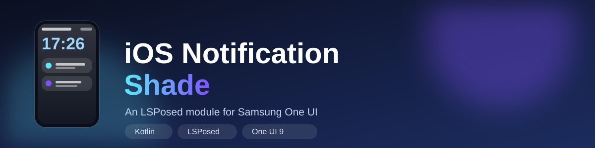

<div align="center">

# iOS Notification Shade

### An LSPosed module that gives Samsung One UI an iOS-style Notification Center

[](https://www.android.com/)
[](https://github.com/LSPosed/LSPosed)
[](https://www.samsung.com/)
[](https://kotlinlang.org/)
[](LICENSE)

<br>



<br>

> Pull down the status bar. Get a clean, finger-tracked, iOS-inspired
> notification center — built on top of Samsung's **original** depth-effect clock,
> with zero risk of bootloops.

</div>

---

## ✨ Features

- 🍎 **iOS-style Notification Center** — a frosted, rounded sheet that follows your finger 1:1
- 🕐 **Original Samsung clock** — the real One UI lock-screen clock with its depth effect, never repainted
- 📶 **Custom status bar** — iOS-like time, carrier, cellular / Wi-Fi / battery glyphs drawn on canvas
- 🎚️ **Natural gestures** — raw-finger tracking, velocity-aware settle, swipe-up to close, spring animations
- 🔦 **Lock-screen controls** — working flashlight toggle + camera shortcut
- 🃏 **Swipe-to-dismiss cards** — flick a notification away with a slop-aware gesture
- 🔒 **Privacy & stability first** — keyguard-aware rendering, PIN screen untouched, stock shade restored on close
- 🛡️ **Anti-bootloop by design** — every hook wrapped in `try/catch (Throwable)`; stock behavior always survives

## 🎯 Target

| | |
|---|---|
| **OS** | Samsung One UI 9 (Android 16 / API 36), tested on Galaxy S24 FE |
| **Min SDK** | 35 (Android 15) |
| **Scope** | `com.android.systemui` only |
| **Root** | KernelSU + Zygisk + LSPosed (Magisk should also work) |

> The module runs **only inside the SystemUI process**, which starts after Android boots.
> It is a normal APK — uninstalling it returns the phone to 100% factory behavior.

---

## 🚀 Install

1. Install the APK:
   ```bash
   adb install -r app-debug.apk
   ```
2. Open **LSPosed Manager → Modules**, enable **iOS Notification Shade**, scope **System UI** (`com.android.systemui`).
3. Soft reboot (LSPosed → ⋮ → Soft reboot) or restart SystemUI:
   ```bash
   adb shell su -c 'killall com.android.systemui'
   ```
4. Pull down the status bar from the **left** side.

> ⚠️ Pulling from the right side intentionally opens the **stock Control Center** — untouched.

### Build from source

```bash
gradle assembleDebug --no-daemon
```

Output: `app/build/outputs/apk/debug/app-debug.apk`

*JDK 17 · Android SDK 36 · AGP 8.7.3 · Kotlin 2.0.21 · Xposed API 82 (`compileOnly`)*

---

## 🧠 How it works

```
SystemUI (com.android.systemui)
│
├── Hooks
│   ├── ShadeOverlayHook            → injects the overlay into the shade window
│   ├── PanelExpansionHook          → expansion fraction + status-bar state
│   ├── ControlCenterGuardHook      → window-level finger tracking + CC detection
│   ├── NotificationSourceHook      → notification data (proxy + field scrape)
│   ├── StockShadeSuppressorHook    → pins the stock stack invisible
│   └── ExpandMotionHook            → early Control Center detection
│
├── Core
│   ├── FingerTracker               → raw Y, absolute sheet offset
│   ├── ShadeEventBus               → coalesced main-thread events
│   └── ModuleConfig                → tunables / debug flags
│
├── Overlay
│   └── ShadeOverlayController      → show/hide lifecycle, suppression, clock reparent
│
└── View
    ├── IOSNotificationShadeView    → sheet, wallpaper, clock, cards, buttons
    ├── StatusBarView               → canvas-drawn iOS status bar (inset-aware)
    ├── NotifCardView               → glass notification card + swipe-to-dismiss
    └── ShadeMotion                 → the single authoritative expansion + physics
```

### Safety model

- **Zero-crash contract** — every hook body is wrapped; a One UI rename degrades to stock + a WARN log.
- **Stock restore** — on close/keyguard, all suppressed views, clock layers and window params are handed back.
- **PIN protection** — the keyguard/PIN shares the shade window; the module never touches its blur/flags and backs off completely on keyguard state.
- **No window blur mutation** — the plain-wallpaper look is achieved by hiding the in-view `CapturedBlurContainer`, never by editing window flags.

---

## 🔧 Troubleshooting

Open **LSPosed Manager → Logs** and search for `IOSNotifShade`.

| Log line | Meaning |
|---|---|
| `SystemUI loaded: process=com.android.systemui` | Module loaded ✅ |
| `Overlay attached to ...NotificationShadeWindowView` | Hook injection works ✅ |
| `Overlay shown (fraction=..., state=...)` | Panel is up ✅ |
| `Method not found: ...` | Signature mismatch — check your One UI build |

**Recovery ladder:** toggle the module off in LSPosed → reboot → stock shade returns. For the stubborn case: `adb shell pm disable-user --user 0 com.iosshade.systemui` → reboot.

---

## 📜 License & credits

MIT. Reference hook patterns were informed by decompiling One UI SystemUI (JADX) and the
ControlCenter module (`dev.flexy.controlcenter`). Inter fonts are bundled; **SF Pro is
user-supplied and intentionally not redistributed**.

<div align="center">

Made with ☕ and a rooted Samsung.

</div>
